# Schema Reference — `marketplace`

Generated from migrations `V1`–`V27`
(`backend/src/main/resources/db/migration`). Status columns are plain
varchars whose allowed values are enforced by the application state
machines (`*StateMachine` classes).

The schema is aligned to the **System Requirements, Architecture and Design
Specification, version 2.0**. `V27` is additive and introduces the missing
data structures and integrity controls from that baseline; see
[requirements traceability](./requirements-traceability.md). Sensitive
identity and bank values are expected to be encrypted by the application
before storage. Existing legacy plaintext identity columns are retained for
compatibility and require an application-assisted data migration before they
can be retired.

## Entity relationship diagram

```mermaid
erDiagram
    users ||--o{ user_roles : "has"
    users ||--o{ user_sessions : "owns"
    roles ||--o{ user_roles : "granted via"
    roles ||--o{ role_permissions : "grants"
    permissions ||--o{ role_permissions : "granted via"

    users ||--o| farmers : "linked to"
    users ||--o| organizations : "linked to"
    users ||--o| personal_buyers : "linked to"
    users ||--o| drivers : "linked to"
    users ||--o{ notifications : "receives"
    users ||--o{ operator_tasks : "assigned"

    farmers ||--o{ farms : "owns"
    farms ||--o| farm_locations : "located at"
    farmers ||--o{ pickup_records : "picked up from"

    organizations ||--o{ organization_documents : "submits"

    drivers ||--o{ vehicles : "drives"
    drivers ||--o{ logistics_assignments : "assigned to"
    drivers ||--o{ delivery_records : "delivers"
    drivers ||--o{ payouts : "paid via"

    products ||--o{ grain_varieties : "described by"
    products ||--o{ inventory_accounts : "tracked in"
    products ||--o{ listings : "offered as"

    inventory_accounts ||--o{ inventory_transactions : "movement history"

    listings ||--o{ order_items : "ordered as"
    products ||--o{ order_items : "sold as"
    orders ||--o{ order_items : "contains"
    orders ||--o{ order_state_history : "state trail"
    orders ||--o{ payments : "paid by"
    orders ||--o{ logistics_assignments : "transported via"
    orders ||--o{ pickup_records : "picked up"
    orders ||--o{ delivery_records : "delivered as"
    orders ||--o{ disputes : "disputed"

    payments ||--o{ payment_transactions : "gateway activity"
    payments ||--o{ payment_allocations : "allocated to"

    ledger_accounts ||--o{ journal_lines : "posted to"
    journal_entries ||--o{ journal_lines : "composed of"
    fee_rules ||--o{ fee_calculations : "computed as"

    notifications ||--o{ notification_deliveries : "delivery attempts"

    logistics_assignments ||--o{ pickup_records : "drives"
    logistics_assignments ||--o{ delivery_records : "drives"
```

## Identity & access (V1–V3)

### `users`
| Column | Type | Notes |
| --- | --- | --- |
| id | BIGINT PK | identity |
| username | VARCHAR(64) | NOT NULL, UNIQUE |
| email | VARCHAR(128) | UNIQUE |
| phone | VARCHAR(32) | UNIQUE |
| password_hash | VARCHAR(100) | NOT NULL (BCrypt) |
| status | VARCHAR(32) | NOT NULL account state |
| password_change_required | BOOLEAN | NOT NULL |
| failed_login_attempts | INTEGER | NOT NULL |
| locked_until | TIMESTAMP | account lockout |
| last_login_at / created_at / updated_at | TIMESTAMP | `created_at` NOT NULL |

### `roles`, `permissions`, `role_permissions`, `user_roles`
- `roles(code UNIQUE, name, description)`, `permissions(code UNIQUE, name, description)`
- `user_roles(user_id → users, role_id → roles)` UNIQUE(user_id, role_id)
- `role_permissions(role_id → roles, permission_id → permissions)` UNIQUE(role_id, permission_id)

### `user_sessions`
`user_id → users`, `refresh_token_hash`, `expires_at`, `revoked_at`, `created_at`.

## Party profiles (V4–V9)

- **`farmers`** — `user_id → users`, `full_name`, `national_id` UNIQUE, `phone` UNIQUE,
  `region/zone/woreda`, `verification_status`, `verified_at`, timestamps.
- **`farms`** — `farmer_id → farmers` (indexed), `name`, `farm_type`,
  `size_hectares NUMERIC(10,2)`, `certification_status`, timestamps.
  **`farm_locations`** — `farm_id → farms`, `region/zone/woreda/village`,
  `latitude NUMERIC(9,6)`, `longitude NUMERIC(9,6)`.
- **`organizations`** — `user_id → users`, `name`, `tax_id`/`registration_number` UNIQUE,
  contact fields, `verification_status/notes/verified_at`, timestamps.
  **`organization_documents`** — `organization_id → organizations`, `document_type`,
  `storage_key`, `status`, `uploaded_at`.
- **`personal_buyers`** — `user_id → users`, `full_name`, `phone` UNIQUE, `email`,
  `region`, `kyc_status`, timestamps.
- **`drivers`** — `user_id → users`, `full_name`, `license_number` UNIQUE,
  `license_expires_at`, `phone` UNIQUE, `status`, `rating NUMERIC(3,2)`, timestamps.
  **`vehicles`** — `driver_id → drivers` (indexed), `plate_number` UNIQUE,
  `vehicle_type`, `capacity_kg NUMERIC(10,2)`, `insurance_expires_at`, `status`, `created_at`.

## Catalog & stock (V10–V12)

- **`products`** — `name`, `slug` UNIQUE, `description`, `category`, `unit`,
  `status`, `created_by`, timestamps.
- **`grain_varieties`** — `name`, `crop_type`, `region`, `maturity_days`,
  `protein_percent NUMERIC(5,2)`, `notes`, `created_at`.
- **`inventory_accounts`** — `owner_type/owner_id`, `product_id → products`,
  `quantity`/`reserved_quantity NUMERIC(19,3)`, `unit`, timestamps,
  UNIQUE(owner_type, owner_id, product_id). Available stock = quantity − reserved.
- **`inventory_transactions`** — `account_id → inventory_accounts` (indexed),
  `type`, `quantity NUMERIC(19,3)`, `reference_type/reference_id`,
  `balance_after`, `created_at` (append-only movement history).
- **`listings`** — `seller_type/seller_id`, `product_id → products`,
  `quantity_available NUMERIC(19,3)`, `unit`, `price_per_unit NUMERIC(19,2)`,
  `currency`, `status`, `region`, `starts_at/ends_at`, timestamps; indexes on
  seller, product and status.

## Commerce (V13–V14)

- **`orders`** — `order_number` UNIQUE, `buyer_type/buyer_id`, `status`,
  `payment_status`, `total_amount NUMERIC(19,2)`, `currency`, `delivery_region`,
  `delivery_address`, `notes`, `placed_at`, timestamps.
- **`order_items`** — `order_id → orders`, `listing_id → listings`,
  `product_id → products`, `quantity NUMERIC(19,3)`, `unit`,
  `unit_price/line_total NUMERIC(19,2)`.
- **`order_state_history`** — `order_id → orders`, `from_status`, `to_status`,
  `changed_by`, `reason`, `changed_at` (audit of every transition).
- **`payments`** — `order_id → orders`, `payer_type/payer_id`,
  `amount NUMERIC(19,2)`, `currency`, `method`, `status`, `gateway`,
  `gateway_reference`, `created_at/updated_at/paid_at`.
- **`payment_transactions`** — `payment_id → payments`, `type`, `amount`,
  `status`, `gateway_payload VARCHAR(2000)`, `processed_at`, `created_at`.
- **`payment_allocations`** — `payment_id → payments`, `target_type/target_id`,
  `amount`, `created_at` (splits a payment across orders/fees/payouts).

## Money movement (V15–V17)

- **`ledger_accounts`** — `code` UNIQUE, `name`, `account_type`,
  `owner_type/owner_id`, `currency`, `created_at`.
- **`journal_entries`** — `entry_date DATE`, `reference_type/reference_id`,
  `description`, `status`, `created_at`; indexed by reference.
- **`journal_lines`** — `entry_id → journal_entries`, `account_id → ledger_accounts`,
  `direction` (DEBIT/CREDIT), `amount NUMERIC(19,2)`, `currency`.
  Every entry must balance (application-enforced).
- **`fee_rules`** — `name`, `fee_type`, `percentage NUMERIC(7,4)`,
  `fixed_amount NUMERIC(19,2)`, `currency`, `applies_to`, `active`,
  `valid_from/valid_to`, `created_at`.
- **`fee_calculations`** — `reference_type/reference_id`,
  `fee_rule_id → fee_rules`, `base_amount`, `fee_amount`, `currency`,
  `calculated_at`.
- **`payouts`** — `payee_type/payee_id`, `amount NUMERIC(19,2)`, `currency`,
  `status`, `period_start/period_end DATE`, `reference`, `processed_at`,
  `created_at`; indexed by payee and status.

## Fulfilment (V18–V20)

- **`logistics_assignments`** — `order_id → orders`, `driver_id → drivers`,
  `vehicle_id → vehicles`, `status`, pickup/dropoff addresses,
  `quoted_price NUMERIC(19,2)`, `currency`, `distance_km NUMERIC(10,2)`,
  `assigned_at`, timestamps.
- **`pickup_records`** — `order_id → orders`, `assignment_id → logistics_assignments`,
  `farmer_id → farmers`, `status`, `scheduled_at/picked_up_at`,
  `location_note`, `received_by`, timestamps.
- **`delivery_records`** — `order_id → orders`,
  `assignment_id → logistics_assignments`, `driver_id → drivers`, `status`,
  `delivered_at`, `received_by`, `proof_note`, `condition_note`, timestamps.

## Engagement & operations (V21–V26)

- **`notifications`** — `user_id → users`, `channel` (IN_APP/SMS/USSD/PUSH),
  `template`, `subject`, `body VARCHAR(2000)`, `status`, `sent_at`, `created_at`.
  **`notification_deliveries`** — `notification_id → notifications`, `provider`,
  `provider_reference`, `status`, `attempt`, `error`, `created_at`.
- **`operator_tasks`** — `task_type`, `status`, `assignee_id → users`,
  `reference_type/reference_id`, `due_at`, `completed_at`, `created_at`.
- **`compliance_cases`** — `case_type`, `status`, `subject_type/subject_id`,
  `opened_by`, `description/resolution VARCHAR(2000)`, `opened_at`, `closed_at`.
  **`disputes`** — `order_id → orders`, `opened_by`, `respondent_id`, `status`,
  `reason/resolution`, `opened_at`, `resolved_at`.
- **`documents`** — `owner_type/owner_id`, `document_type`, `storage_key`,
  `content_type`, `size_bytes`, `checksum`, `created_at`.
- **`audit_events`** — `aggregate_type/aggregate_id` (indexed), `action`,
  `actor_id`, `details VARCHAR(2000)`, `created_at` (append-only).
- **`idempotency_records`** — `idempotency_key` UNIQUE, `request_hash`,
  `response_status`, `response_body VARCHAR(4000)`, `expires_at` (indexed),
  `created_at`.

## Requirements alignment (V27)

- **Identity and onboarding:** sessions now retain state, device, channel,
  last activity and IP metadata. `temporary_credentials` stores only
  single-use credential hashes and expiry/consumption state; `ussd_sessions`
  separates telecom sessions from authenticated application sessions.
  Farmer/driver identity values have encrypted
  storage fields; farmer literacy status is captured. `payout_bank_accounts`
  stores encrypted account numbers, key identifiers, masked values,
  ownership, verification and cooling-off state. `terms_acceptances` records
  policy version, accepting user, time, channel metadata and IP.
- **Farm and grain:** farms have kebele, usage and production information;
  location visibility defaults to private. `grain_lots` records farm,
  variety, harvest year, quantity, storage, grade, moisture, expected price,
  minimum order and availability. Listings gain searchable harvest/quality
  fields and a general location, keeping precise farm coordinates private.
- **Inventory and orders:** inventory accounts gain an optimistic version and
  nonnegative quantity constraints. `inventory_holds` records expiring,
  idempotent soft holds. Orders gain explicit buyer-prepaid fee components,
  hold expiry and version; order items retain farmer and driver fee amounts.
- **Payments and ledger:** payments retain hold/release/refund references and
  timestamps. Fee calculations snapshot fee type, rate, fixed amount, effective
  date and beneficiary. Payouts reference the verified payout account and
  support idempotent provider tracking. `payment_state_history` records
  append-only payment transitions. Deferred PostgreSQL validation enforces
  balanced double-entry journal lines; journal and inventory ledger records
  are append-only.
- **Logistics and governance:** pickup and delivery records hold hashes and
  expiry for verification codes, plus confirmed quantities. Disputes support
  decisions, appeals and evidence. `trip_location_points` stores driver GPS
  samples against an assignment and timestamp; retention and active-trip
  access remain application/policy controls. Audit events include state changes, actor
  role, reason, correlation ID and channel. Operator tasks capture assistance
  channel and resolution.

The requirements baseline is pending stakeholder review. Personal Owner
onboarding details, retention periods, fee policy details, and regulatory
handling of held funds remain subject to the document's listed open issues.
